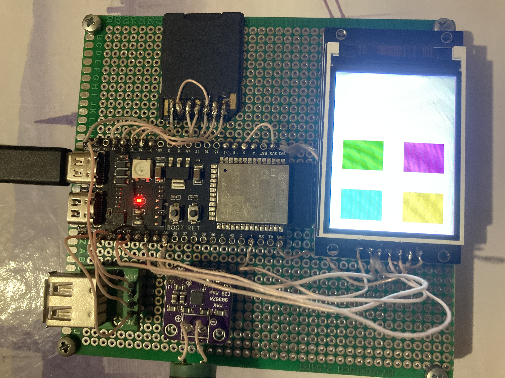
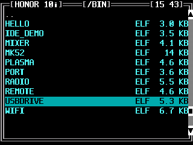
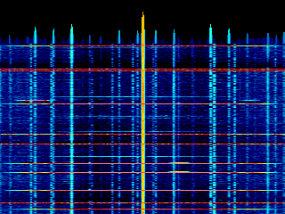

# MACJr

MACJr is a vibecoded research project: an educational Unix-like OS for the
ESP32-S3, built step by step. It is going to live inside the case of a
Soviet *Elektronika MK-52* programmable calculator, using the calculator's
own keyboard.

The system is a text console of 40x15 characters on a 320x240 display.
A small firmware holds the hardware drivers, the tty, a file navigator, a
system monitor and a program loader. Everything else is a program: an ELF
file on the SD card, started from the navigator. The final goal is a proper kernel, a set
of libraries and a cross-compiler.

## The motherboard

This is the first version, hand-wired on a 10x15 cm perfboard and showing a
test pattern on the display.

| Part | What it does |
|---|---|
| ESP32-S3-WROOM-1 N16R8 | The computer: two cores at 240 MHz, 16 MB flash, 8 MB octal PSRAM |
| ST7789 display, 320x240 | The console, with an 8x16 font and CP866 glyphs |
| SD card | Programs, pictures, screenshots and settings |
| MAX98357A I2S amplifier | Sound |
| MCP23018 I/O expander | Reads the 32 keys of the MK-52 over I2C |
| Si5351 clock generator | Local oscillator for a Tayloe detector radio |
| IR receiver and LED | Receives and sends remote control commands |

The last three parts are not in this photo.

## The boot program

The board boots into a file navigator in the style of DOS Navigator: one
panel over the SD card, starting where it was left. The top border shows the
Wi-Fi network, the current directory and the time, set over NTP, with a
blinking colon. The network and the time appear only while they are known.

Each row shows a name, extension and size. Directories come first, and
colour marks the type: directories are white, programs cyan, Python scripts
green, images yellow, sounds purple and everything else grey. Hidden files are left out.

| MK-52 key | Action |
|---|---|
| П→x / x→П | Move the selection |
| В↑ | Open a directory, start a program (an ELF file), or run a Python script |
| Cx | Go up a directory |
| F + K | System monitor: CPU, memory, temperature, SD card |
| F + Cx | Kill the running program |
| F + ↑↓ | Save a screenshot to the SD card, like the one above |
| F + А↑ | USB keyboard on / off: a keyboard plugged into the USB port types too |

When a program ends, the navigator comes back to the same place. After a
reboot it opens the last directory again, on the last program started from
it.

## A spectrogram from the Wi-Fi radio

`ESPSDR.ELF` turns the ESP32-S3's own 2.4 GHz Wi-Fi receiver into a small
software-defined radio. The chip's PHY has a factory debug "dump engine" that
copies raw complex IQ from the receiver's ADC straight into a block of SRAM.
The firmware reserves that block at boot, puts the radio into promiscuous RX
with a forced gain, triggers a one-shot capture and hands the samples back; the
program FFTs them into an averaged periodogram and paints a scrolling
waterfall, 16 MHz wide around channel 1, on the display. It is one of the few
programs allowed to draw on the screen directly instead of through the console.
The radio is borrowed from normal Wi-Fi only while the program runs. Cx exits.

## The journey

It started with the keyboard. The MK-52's 32 keys went to an MCP23018
expander, so two wires could read them all. Two rows stayed silent, and
swapping them in software changed nothing. A small wiring probe showed the
fault was in the wires. The keyboard then became a Unix-style device,
`/dev/kbrd`, that any program can read like a file.

Next came the radio side: an Si5351 driver written from the datasheet, tuned
to 7.055 MHz in quadrature, and a two-channel ADC streamed to a computer as a
USB microphone. A boot menu let us choose between these modes, and its first
screen exposed two display bugs at once: a doubled title and green text
that came out magenta. A system monitor followed, an overlay with CPU, memory
and temperature that puts the screen back when it closes.

Then the board became the calculator whose case it will live in. We pressed
all 32 keys in order to name them, and wrote an MK-52 from its manuals, tested
on the Mac first. To match the real machine exactly it had to truncate
results instead of rounding, with π cut off at `3.1415926`.

Soon after, the board started resetting itself with no backtrace. Adding log
lines made the crash vanish, so we attached a JTAG debugger and found CPU0
stuck inside the PSRAM allocator with its heap corrupted. The cause only
surfaced later, when the crash came back: the LCD reset wire was on GPIO35,
one of the octal PSRAM's data lines. Moving it to GPIO14 ended the crashes.

The board also learned to share. One USB stack now serves as a microphone
or as a card reader for the SD card. A streaming PNG decoder, built on the
inflater in the chip's ROM, shows pictures in about 45 KB of RAM. Settings
went from SQLite (too heavy) to our own text file and finally to FlashDB.

The biggest step was programs as files, the way DOS had them. With
Espressif's ELF loader, apps load from the SD card into PSRAM and run on the
second core, and the firmware shrank to the essentials. New apps no longer
need a reflash, and a build-time checker catches what the loader would
reject.

The system then grew more Unix-like. An IR port replaced the analog inputs.
`select()` came to the keyboard, along with database watches, so programs can
wait instead of polling. Wi-Fi arrived with a scrolling list window, the
console's first real widget. Key chords gave the system a kill: F and Cx end
any program, and its descriptors, memory, USB and SD card are put back.
PNG screenshots came from a shadow framebuffer, and the first zoomed-in
picture showed double-line box corners that nobody had noticed were wrong.
A mixer added volume control to the speaker. Finally the boot menu, which
had run out of digit keys, became the navigator above. Its first header
vanished off the top of the screen, which led to a console that wraps lines
like a real terminal.

Then came a language. MicroPython runs as an ordinary program, started on a
`.py` file from the navigator or as a REPL. Getting there took a stack that
was too big to allocate, and an exception mechanism written for a different
Xtensa calling convention that crashed the board on the first `raise`.
Python wanted keys the calculator doesn't have, so F and А↑ turn the USB
port into a host for a real keyboard, through the host side of the same
TinyUSB stack.

Then the board picked up a radio it already had. The ESP32-S3's Wi-Fi
receiver can dump its raw ADC samples into SRAM through a factory debug
engine, documented by the ESPARGOS esp-sdr project. We reserved that memory
at boot, drove the PHY into a bare promiscuous-RX state, and turned the
samples into the full-screen 2.4 GHz spectrogram above, with the capture in
the firmware and the FFT and waterfall in an ELF.

Then a game asked a hardware question. Conway's Game of Life is a 3x3
convolution plus a threshold, so it looked like a job for the chip's vector
"AI" instructions. It isn't: for a one-bit automaton the fastest path is to
pack the grid one bit per cell and count all eight neighbours with bitwise
full-adders, 32 cells per machine word. The whole 320x240 board advances in
a fraction of a millisecond, drawn straight to the panel. Two familiar traps
surfaced on the way: hammering the hardware random seeded the grid in two
black seconds, and a few kilobytes of resident buffers in internal RAM were
enough to starve the next program's stack. Vector-unit and matrix-multiply
versions were written and timed against it anyway; the plain register won, so
it is the one that stayed.

Then the speaker got files to play. A WAV player streams to the speaker
through a ring of buffers, parsing the RIFF header by reading forward because
the program loader exports no seek. Pressing В↑ on a sound file in the
navigator launches it, the way В↑ on a script launches Python. An MP3 decoder
was fitted and then taken back out, leaving a small WAV player and a reusable
audio pipeline.

So far this is step one, full hardware support. The SoftRock radio is
unfinished, because the USB microphone never worked well. Ahead lie the
kernel, with processes, memory and file systems, then a standard library, a
cross-compiler and more programs.

The full log is in 15 short topic stories, with code and real logs, in
[journey/](journey/).
