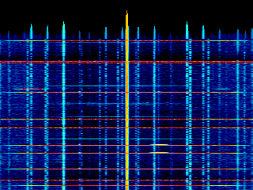

# 13. A radio hiding in the Wi-Fi chip

The ESP32-S3 already has a 2.4 GHz receiver on board: the Wi-Fi radio. MACJr
now uses it as a small software-defined radio and paints the band as a
full-screen spectrogram, `ESPSDR.ELF`.



## The dump engine

The chip's PHY has a factory debug feature that production firmware never
exposes: a "dump engine" that copies raw complex IQ from the receiver's
baseband ADC straight into SRAM, one 32-bit word per sample. The mechanism is
documented by the [ESPARGOS esp-sdr](https://github.com/ESPARGOS/esp-sdr)
project; we read their `docs/how-it-works.md` and receiver code, and wrote a
minimal snapshot-only backend for it.

Each word is packed: bits 0-9 are I, bits 10-19 are Q, both 10-bit signed, and
bits 20-27 carry the gain the AGC used. A snapshot of a few thousand words
takes about 0.2 ms.

The engine writes to a fixed block of memory, so that block cannot also belong
to the heap or to a static section — otherwise it would scribble over live
data. The firmware claims it at boot, before the allocator sees the RAM:

```c
#define IQ_BASE 0x3fcd0000u
#define IQ_END  0x3fce0000u          /* 64 KB aperture */
SOC_RESERVE_MEMORY_REGION(IQ_BASE, IQ_END, espsdr_dump);
```

## Taking the radio

Capture has to live in the firmware, not in a program: the memory reservation
is a boot-time decision, and the register sequence reaches into PHY internals.
`espsdr_start()` brings Wi-Fi up (without connecting), switches it to
promiscuous RX on a fixed channel, turns the transmitter off, enables the RX
clock and forces a fixed gain so the picture is a steady relative-power plot
rather than one the AGC keeps re-levelling:

```c
esp_wifi_set_promiscuous(true);
esp_wifi_set_channel(1, WIFI_SECOND_CHAN_NONE);
stop_tx_tone(1);
rom_pbus_workmode();
rom_pbus_xpd_tx_off();
rom_pbus_xpd_rx_on(1);
rom_set_rxclk_en(1);
force_rx_gain(1, 55, 0);
```

Those `rom_*`, `set_chanfreq` and `force_rx_gain` helpers live in the chip's RF
test library, `librftest.a`, which only gets linked when
`CONFIG_ESP_PHY_ENABLE_CERT_TEST=y`. Taking the radio this way suspends normal
Wi-Fi networking; `espsdr_stop()` drops promiscuous mode and gives it back.

A snapshot clears the aperture to a sentinel, points the engine at it, pulses
the trigger bit, waits for the done bit, then copies the samples out. If any
word is still the sentinel the capture came up short and the frame is dropped.
The firmware exports just four calls — `espsdr_start`, `espsdr_tune`,
`espsdr_snapshot`, `espsdr_stop` — so the rest is an ordinary program.

## The picture

`ESPSDR.ELF` is one of the few programs that draws on the display directly,
like the PNG viewer, instead of through the console. Each frame it snapshots
`256 * 16` IQ words at 16 MS/s, applies a Hann window, runs an in-place
radix-2 FFT on every 256-sample block and averages the sixteen periodograms.
An `fftshift` puts DC in the middle so the tuned channel sits at screen
centre, 62.5 kHz per bin across 16 MHz.

Power goes to dB, and the noise floor is tracked with a slow follower rather
than fixed:

```c
if (!s_floor_set) { s_floor = fmin; s_floor_set = true; }
else s_floor += 0.10f * (fmin - s_floor);
```

Everything above the floor is spread across a 40 dB,
black-blue-cyan-green-yellow-red-white palette. The 256 FFT bins are
interpolated to the full 320-pixel width, so the waterfall fills the screen.
Each frame the waterfall scrolls down one row with a `memmove`, the newest
line is drawn on top, and a small spectrum graph rides above it. The bright
vertical streaks in the shot are real Wi-Fi and Bluetooth traffic in the room.

The program pauses while the system monitor (F + K) is open, since the monitor
owns the screen, and a non-blocking read of `/dev/kbrd` lets Cx exit.

**Result:** the board's own Wi-Fi radio as a 16 MHz-wide spectrum analyser —
capture in the firmware HAL, FFT and waterfall in a 2.4 GHz SDR program loaded
from the SD card. No transmit: it only listens.
